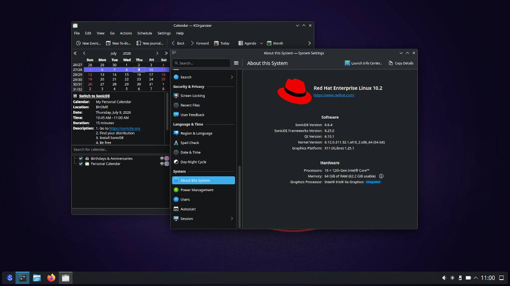

# SonicDE for Enterprise Linux 10 and Fedora

This third-party repository provides [SonicDE](https://sonicde.org) source and binary packages for [Enterprise Linux](https://www.redhat.com/en/technologies/linux-platforms/enterprise-linux)-based distributions and for [Fedora](https://fedoraproject.org/). SonicDE, or the Sonic Desktop Environment, aims to preserve and improve the X11-specific aspects of KDE. You can learn more about SonicDE at [sonicde.org](https://sonicde.org/).

The packages of this repository are known to work with [AlmaLinux](https://almalinux.org/), [Red Hat Enterprise Linux (RHEL)](https://www.redhat.com/en/technologies/linux-platforms/enterprise-linux) and Fedora. They also should on [Oracle Linux](https://www.oracle.com/linux) and [Rocky Linux](https://rockylinux.org).

Since SonicDE completed its hard fork of KDE Frameworks and Plasma, this repository packages the complete SonicDE stack itself: the frameworks (currently 6.31.0.x), the workspace (currently 6.8.2) and the applications (26.08.x). The very same versions are built for EL10 and for Fedora, so neither distribution's KDE packages decide which SonicDE version you get. The SonicDE packages carry `Provides`/`Conflicts` for the corresponding `kf6-*` and `plasma-*` packages, so they replace their EPEL/Fedora counterparts instead of coexisting with them.

## Installing SonicDE Manually

### Choosing an X11 Display Server

EL10 has no X11 server by default or in the official repos, and Fedora no longer ships one either, so you need to install one. We recommend using the XLibre X11 server. Follow the installation instructions on the [XLibre for Fedora and EL GitHub page](https://github.com/xlibre-fedora-el/rpmspecs).

### Before You Install

> [!warning]
> Beware that SonicDE has removed the Wayland parts, so the Wayland session may not work after installing it. You may not be able to start KDE Wayland anymore. Proceed at your own risk.

> [!note]
> On EL10 the EPEL repository is still needed for build and runtime dependencies. The per-platform instructions below enable it for you (`epel-release`). Installing the whole "KDE Plasma Workspaces" group first is no longer necessary.

### Installing SonicDE

`sonic-desktop` is the metapackage that pulls in the complete environment — `sonic-workspace`, `sonic-win`, `sonic-desktop-interface`, `sonic-login-manager`, the frameworks, apps and `xorg-x11-server-Xorg`. Enable the repository for your platform and run:

#### Fedora

```shell
sudo dnf copr enable @SonicDE/SonicDE
sudo dnf install --allowerasing sonic-desktop
sudo dnf upgrade --allowerasing
sudo systemctl enable --force soniclogin.service
```

#### RHEL 10 and binary-compatible clones (AlmaLinux x86_64, Rocky, Oracle)

```shell
sudo dnf install -y epel-release dnf-plugins-core
sudo dnf copr enable @SonicDE/SonicDE rhel+epel-10-x86_64
sudo dnf install --allowerasing sonic-desktop
sudo dnf upgrade --allowerasing
sudo systemctl enable --force soniclogin.service
```

On RHEL itself, EPEL additionally requires the CodeReady Builder repository: `sudo subscription-manager repos --enable codeready-builder-for-rhel-10-$(arch)-rpms`. On the clones the equivalent is `sudo dnf config-manager --set-enabled crb`.

#### CentOS Stream 10

```shell
sudo dnf install -y epel-release dnf-plugins-core
sudo dnf copr enable @SonicDE/SonicDE
sudo dnf install --allowerasing sonic-desktop
sudo dnf upgrade --allowerasing
sudo systemctl enable --force soniclogin.service
```

#### AlmaLinux 10 on x86_64_v2-capable CPUs

`dnf copr enable` cannot be used for this variant: COPR's generated repository file always expands to `alma+epel-10-$basearch` (i.e. `x86_64`), while the x86_64_v2 packages are published under `alma+epel-10-x86_64_v2`. Create the repo file explicitly instead:

```shell
sudo dnf install -y epel-release
sudo tee /etc/yum.repos.d/copr-sonicde.repo <<'EOF'
[copr-sonicde]
name=Copr repo for SonicDE owned by @SonicDE
baseurl=https://download.copr.fedorainfracloud.org/results/@SonicDE/SonicDE/alma+epel-10-x86_64_v2/
type=rpm-md
skip_if_unavailable=True
gpgcheck=1
gpgkey=https://download.copr.fedorainfracloud.org/results/@SonicDE/SonicDE/pubkey.gpg
repo_gpgcheck=0
enabled=1
enabled_metadata=1
EOF
sudo dnf install --allowerasing sonic-desktop
sudo dnf upgrade --allowerasing
sudo systemctl enable --force soniclogin.service
```

#### ARM (aarch64) and POWER (ppc64le)

Builds are published for `aarch64` and `ppc64le` on Fedora, CentOS Stream and RHEL/clones — only the AlmaLinux variant above is x86_64-only. On Fedora and CentOS, `sudo dnf copr enable @SonicDE/SonicDE` detects your architecture automatically. On EL10, pass the chroot matching your platform and architecture, e.g. `sudo dnf copr enable @SonicDE/SonicDE rhel+epel-10-aarch64` or `rhel+epel-10-ppc64le`.

Note that on ppc64le there is no Qt WebEngine (an upstream V8 porting gap — Fedora does not ship it either), so WebEngine-based applications are unavailable on that architecture.

The `sonic-login-manager` display manager is installed by the metapackage — `systemctl enable --force soniclogin.service` switches to it. Alternatively you can keep [SDDM](https://en.wikipedia.org/wiki/Simple_Desktop_Display_Manager), optionally with the Sonic Silver theme from `silver-sddm`:

```shell
sudo dnf install sddm silver-sddm
sudo systemctl enable --force sddm.service
```

### Rebooting Your System

Now reboot your system. Log in with your credentials, start the program System Settings and verify that you’re running SonicDE on the “About this System” page. You do? Congratulations!

If your system only shows a blinking cursor after the reboot, switch to a [text console](https://wiki.archlinux.org/title/Linux_console) via, e.g., Ctrl+Alt+F3, log in as your regular user and enter the following commands:

```shell
sudo dnf reinstall sddm
sudo systemctl restart sddm
```

## Building the Packages

Every package lives in its own directory named after the package and contains a single spec file. Sources are the release tags of the [SonicDE repositories](https://github.com/Sonic-DE/) — never `download.kde.org` and never the `v`-prefixed tags inherited from KDE.

`build-order.txt` lists the packages in dependency tiers computed from the `BuildRequires` of every spec by `ci/generate-build-order.py`. Packages within a tier are independent; each tier needs the previous ones.

```shell
# Parse every spec and check it against build-order.txt
ci/parse-specs.sh

# Build one tier in mock, for EL10 and for Fedora
ci/build-tier.sh tier1 alma+epel-10-x86_64
ci/build-tier.sh tier1 fedora-43-x86_64

# Submit builds to Copr, tier by tier
./copr-build.sh all
```

`sonic-rpm-macros` provides the `%_kf6_*` paths and the `%cmake_kf6` macro family. It replaces `kf6-rpm-macros`, so it must be built and installed first — it is in the first tier for that reason. Directory ownership still comes from the distribution's `kf6-filesystem`, which contains no KDE code.

## Getting in Contact

Please report any enhancement requests or issues with this repository at [Issues · sonicde-fedora-el/rpmspecs](https://github.com/sonicde-fedora-el/rpmspecs/issues). In case you need help, want to report success or talk about other aspects, please also check the official SonicDE channels.

&nbsp;[Bluesky](https://bsky.app/profile/sonicdesktop.bsky.social)&nbsp; &nbsp;[Discord](https://discord.gg/cNZMQ62u5S) &nbsp; &nbsp;[Mastodon](https://mastodon.social/@sonicdesktop) &nbsp; &nbsp;[Matrix](https://matrix.to/#/#sonicdesktop:matrix.org) &nbsp; &nbsp;[OFTC IRC](https://webchat.oftc.net/?channels=sonicde%2Csonicde-devel%2Csonicde-dist&uio=MT11bmRlZmluZWQb1) &nbsp; &nbsp;[Telegram](https://t.me/sonic_de) &nbsp; &nbsp;[X (Twitter)](https://x.com/SonicDesktop)

